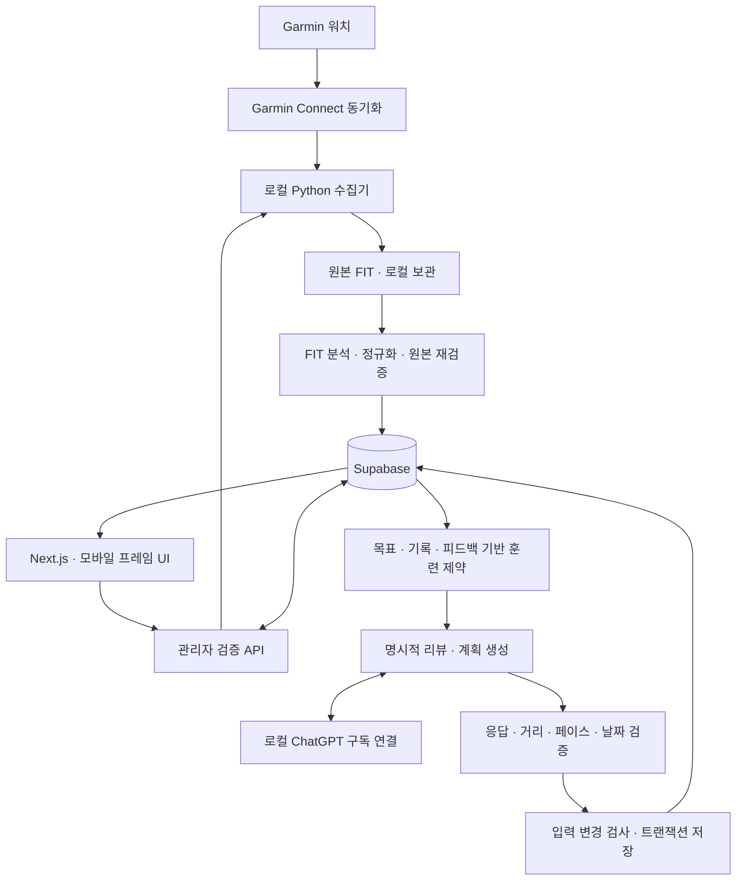

# Traini

**Garmin 러닝 기록과 여러 대회 목표를 연결하는 개인 러닝 코치.**

매주 실제로 달린 기록을 확인하고, 현재 컨디션과 목표에 맞는 다음 훈련을 준비합니다.
Garmin FIT 수집부터 주간 요약, 훈련계획, 수행 피드백과 주간 리뷰까지 하나의 흐름으로 구성했습니다.

> 현재 운영 형태는 **한 명의 Google 관리자 계정과 로컬 macOS 서버를 사용하는 개인용 서비스**입니다.
> 일반 사용자 가입이나 공개 클라우드 운영을 제공하는 서비스는 아닙니다.

[사용·설정 안내](docs/personal-service-guide.md) · [전체 문서](docs/README.md) · [검증·출시 확인](docs/service-readiness.md)

## 왜 만들었나요?

고정된 훈련표는 실제로 소화한 거리, 빠진 훈련, 컨디션 변화와 여러 대회 일정을 충분히 반영하기 어렵습니다.
Traini는 전체 장기 일정을 확정하는 대신, 기록을 근거로 **이번 주 남은 일정과 다음 주 계획을 각각 갱신**합니다.
목표 기록은 방향으로 사용하고, 달성 가능한 현재 능력으로 간주하지 않습니다.

Garmin 개발자 API 승인을 전제로 했던 디자인 프로토타입에서 출발해,
개인이 직접 사용할 수 있는 **로컬 Garmin Connect 수집기 + FIT 기반 서비스**로 전환했습니다.

## 구현된 기능

| 영역 | 현재 동작 |
| --- | --- |
| Garmin 기록 가져오기 | 버튼 한 번으로 러닝 조회 → FIT 다운로드 → 분석 → Supabase 업로드 → 주간 요약 갱신 |
| 실제 기록 분석 | 거리·타이머 시간·가중 평균 페이스·최장 거리와 최근 8주 기록 비교. FIT에 있는 심박·케이던스·랩 근거 활용 |
| 여러 대회 목표 | 최대 8개 대회, 하나의 주목표, 대회별 거리·날짜·목표 기록과 훈련 가능 요일 설정 |
| 훈련계획 | ChatGPT 구독 연결 후 명시적으로 생성. 회복·이지·롱런·템포·인터벌·휴식을 근거에 맞게 배치하고 구간 거리·반복·회복을 검증 |
| 대회 일정 반영 | 준비·테이퍼·대회·회복 및 복귀 확인을 구분. 여러 대회 간 충돌과 최근 기록·컨디션 반영 |
| 수행 기록·피드백 | Garmin 활동 연결, 직접 완료·건너뜀과 사유, RPE·피로·통증·메모. 지난 훈련 날짜에도 기록 가능 |
| 주간 마감·리뷰 | 일요일에 이번 주를 명시적으로 마감하고 리뷰 가능. 월요일에도 동일한 월~일 날짜 범위를 이어서 사용 |
| 진행 화면 | 오늘·일정·로드맵·러닝 분석·마이에서 저장된 계획, 실제 기록과 누락·오래된 데이터 상태 표시 |
| 날씨 참고 | 사용자가 위치 조회를 요청하면 현재 날씨·훈련 시간대 예보 확인. 규칙 기반 참고 안내이며 원래 처방은 보존 |
| 관리자 접근 | Google 로그인, 서버 세션·Next.js Proxy·API 관리자 검사·Supabase RLS로 접근 제한 |

모든 훈련 종류를 매주 강제로 넣지 않습니다. 기록 부족을 휴식이나 피로로 단정하지 않으며,
놓친 훈련을 다음 일정에 무조건 보충하지 않습니다. 통증·몸 상태 이상 보고는 자동으로 해제하지 않습니다.

## 한 주의 사용 흐름

1. **기록 가져오기** — 워치를 Garmin Connect 앱에 동기화하고 Traini에서 대상 주간을 확인합니다.
2. **수행 확인** — 활동 연결을 검토하고 필요한 완료·건너뜀·컨디션 피드백을 남깁니다.
3. **주간 마감** — 일요일에 훈련을 모두 마쳤다면 이번 주 마감을 확인합니다. 월요일에는 지난주가 이미 달력상 완료된 주입니다.
4. **주간 리뷰** — 기록의 핵심 평가와 다음 훈련 방향을 별도 버튼으로 생성·확인합니다.
5. **계획 갱신** — 원하는 주로 이동해 계획을 생성하거나 업데이트합니다. 완료한 훈련은 유지합니다.

웹 가져오기는 훈련 시간대의 **일요일에는 이번 주**, 나머지 요일에는 **완료된 지난주**를 기본 선택합니다.
일요일에는 지난주로 전환할 수 있습니다. CLI 기본값은 항상 완료된 지난주입니다.

**가져오기·피드백 저장·마감·조회는 AI를 호출하지 않습니다.** 리뷰와 계획 생성은 각각 명시적으로 실행합니다.
날짜와 시간대에 따른 예외는 [주간 마감 안내](docs/weekly-training-closeout.md)에 정리했습니다.

## 서비스 구조



| 구성 | 기술·역할 |
| --- | --- |
| 웹 | Next.js 16 App Router, React 19, TypeScript, Tailwind CSS·CSS Modules |
| 데이터·인증 | Supabase Postgres·Auth·RLS, Google 관리자 로그인 |
| 수집·분석 | Python 3.12+, `python-garminconnect`, Garmin FIT SDK |
| AI | 별도 로컬 ChatGPT OAuth 연결, 구조화된 응답·의미 검증, 명시적 생성 |
| 날씨 | 서버 측 OpenWeather 조회와 규칙 기반 참고 안내 |
| 검증 | Node test runner, Python unittest, SQL·실제 DB 통합 검사, Playwright 브라우저 시나리오, GitHub Actions |

브라우저는 서버 키나 Garmin·ChatGPT 토큰을 받지 않습니다. 원본 FIT는 로컬에 보관하고,
DB에는 검증된 활동 필드와 랩 근거를 저장합니다. AI 생성 시에는 목표·훈련 기록·자기보고 등
선별된 입력이 OpenAI로 전송됩니다. 자세한 경계는 [데이터·개인정보 안내](docs/personal-service-guide.md#데이터와-개인정보)를 참고하세요.

## 실행하기

필요 환경은 **macOS, Node.js 22, Python 3.12 이상**, 설정된 Supabase 프로젝트와 Google 관리자 계정입니다.

```sh
npm ci
python3 -m venv collector/.venv
collector/.venv/bin/python -m pip install -r collector/requirements.lock
collector/.venv/bin/python -m pip install --no-deps -e ./collector
```

환경변수, 관리자 설정, 최초 Garmin 로그인과 ChatGPT 연결을 완료한 뒤 실행합니다.

```sh
npm run service:check
npm run dev -- --port 3017
```

[로컬 Traini 열기](http://localhost:3017/today)

**현재 업로더·관리 명령에는 기존 Supabase 프로젝트를 확인하는 제한이 있습니다.**
다른 프로젝트로 복제할 때 환경변수만 바꾸면 실행되는 범용 템플릿은 아닙니다.
기존 환경 재실행과 신규 환경 준비를 구분한 [설정 안내](docs/personal-service-guide.md)를 먼저 확인하세요.

## 검증하기

아래 검사는 개인 계정 연결이나 실제 AI 추론 없이 실행합니다.

```sh
npm test
collector/.venv/bin/python -m unittest discover -s collector/tests -q
npm run lint
npm run typecheck
npm run build
```

브라우저 회귀 검사는 별도로 실행합니다.

```sh
npx playwright install chromium
npm run test:e2e
```

브라우저 검사는 합성 데이터 서버를 사용하며 실제 OAuth·Proxy·DB 트랜잭션 검사를 대신하지 않습니다.
실제 DB 통합 검사, 선택적 외부 서비스 검사와 GitHub 필수 검사는
[검증·출시 확인](docs/service-readiness.md) 및 [CI 안내](docs/continuous-integration.md)에 구분했습니다.

## 현재 범위와 제약

- 수면·HRV·VO₂ Max·회복 점수·VDOT·예상 완주 기록을 자동 수집·계산하는 기능은 제공하지 않습니다.
- Garmin 워치로 훈련을 전송하거나 워치에서 훈련을 시작하는 기능은 없습니다.
- 예약 수집·자동 계획 재생성은 없습니다. Mac과 서버가 켜져 있어야 웹 가져오기를 사용할 수 있습니다.
- 구독 연결과 수집기는 로컬 Mac 기준이며 Vercel에서 동일하게 동작하지 않습니다. 휴대폰의 `localhost`는 Mac 서버를 가리키지 않습니다.
- 리뷰·계획 생성은 최근 24시간 합계 5회와 60초 간격 제한을 공유합니다. 실패 시도도 포함하며, 제공자의 구독 한도와는 별개입니다.
- 유료 API 키로 자동 전환하거나 실패한 AI 요청을 자동 재시도하지 않습니다. 크레딧·자동 충전 허용 여부는 사용자가 제공자 계정에서 관리합니다.
- 훈련 규칙과 응답 검증은 제품의 제한 조건입니다. 부상 진단·복귀 허가 또는 목표 달성 보장을 제공하지 않습니다.

## 문서 읽는 순서

| 목적 | 문서 |
| --- | --- |
| 직접 실행하고 매주 사용하기 | [개인 서비스 가이드](docs/personal-service-guide.md) |
| 구현 기능과 코드 구조 살펴보기 | [문서 지도](docs/README.md) |
| 실패 대응·한도 확인 | [운영·복구](docs/service-reliability.md) |
| 일요일 마감·월요일 계획 연결 | [주간 마감](docs/weekly-training-closeout.md) |
| 테스트 범위·남은 운영 확인 | [검증·출시 확인](docs/service-readiness.md) |

초기 프로토타입의 구상은 Git 이력에 남아 있습니다. 이 README는 현재 구현된 동작을 기준으로 설명합니다.
